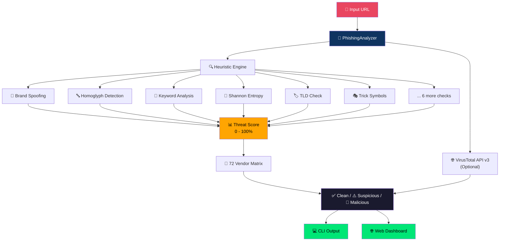
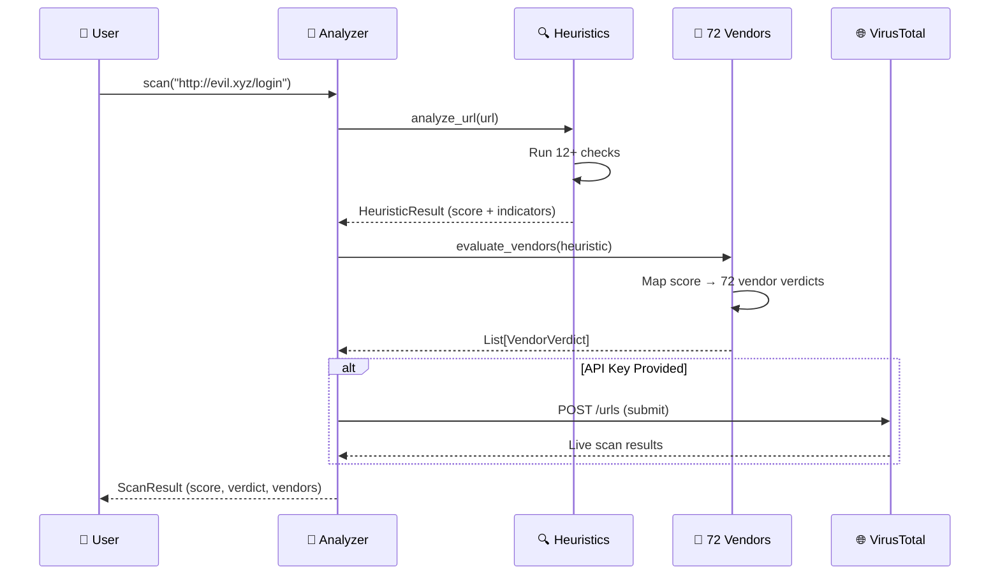

<p align="center">
  
</p>

<h1 align="center">🛡️ Phishing Detector</h1>
<h3 align="center">URL Threat & Risk Analyzer — 72 Security Engines</h3>

<p align="center">
  
  
  
  
</p>

<p align="center">
  
  
  
  
  
</p>

<p align="center"><b>A powerful Python-based security tool that scans any URL to detect phishing, scams & malicious threats using multi-engine consensus logic (72 vendors).</b></p>

---

## 📸 Demo & Screenshots

### 🔴 CLI — Malicious URL Detected
```
╔══════════════════════════════ 🛡️  Scan Report ═══════════════════════════════╗
║ 🔗 URL:  http://paypal-security-update.xyz/login/verify.php                  ║
║ 📡 Source:  Offline Heuristic Engine (72 vendors simulated)                  ║
║                                                                              ║
║ Detection Ratio:  72 / 72                                                    ║
║ Risk Score:       100.0%                                                     ║
║ Verdict:          MALICIOUS / PHISHING 🔴                                    ║
╚══════════════════════════════════════════════════════════════════════════════╝

  ■ Malicious: 72  ■ Suspicious: 0  ■ Clean: 0  ■ Undetected: 0
```

### ✅ CLI — Safe URL
```
╔══════════════════════════════ 🛡️  Scan Report ═══════════════════════════════╗
║ 🔗 URL:  https://www.google.com                                              ║
║                                                                              ║
║ Detection Ratio:  0 / 72                                                     ║
║ Risk Score:       0.0%                                                       ║
║ Verdict:          CLEAN & SAFE ✅                                            ║
╚══════════════════════════════════════════════════════════════════════════════╝

  ✅  No vendors flagged this URL.
```

### 🌐 Web Dashboard — VirusTotal-Style Dark Mode UI
```
┌─────────────────────────────────────────────────────────────────┐
│  🛡️ Phishing Detector    URL Threat & Risk Analyzer             │
├─────────────────────────────────────────────────────────────────┤
│                                                                 │
│  ┌──────────────────────────────────────────────────┐  🔍 Scan │
│  │  Enter URL to scan...                            │          │
│  └──────────────────────────────────────────────────┘          │
│                                                                 │
│  Try: [PayPal Phish] [IP Login] [Google Spoof] [Safe: Google]  │
│                                                                 │
│  ┌──────────┐                                                   │
│  │  ╭────╮  │  Detection Ratio:  69 / 72                       │
│  │  │100%│  │  Verdict:  MALICIOUS / PHISHING 🔴               │
│  │  ╰────╯  │                                                   │
│  │Risk Score│  ■ Malicious: 69  ■ Suspicious: 3                │
│  └──────────┘  ■ Clean: 0       ■ Undetected: 0               │
│                                                                 │
│  🔍 Threat Indicators                                           │
│  ├── 🔴 Potential PAYPAL impersonation                         │
│  ├── ⚠️  Phishing keywords: login, verify, security            │
│  ├── ⚠️  High-risk TLD: .xyz                                   │
│  └── ⚠️  Suspicious path element: .php                         │
│                                                                 │
│  🏢 Security Vendors (72 Engines)                               │
│  [All] [Malicious] [Suspicious] [Clean] [Undetected]           │
│  ┌─────┬──────────────────────┬──────────────┬───────────┐     │
│  │  #  │ Vendor               │ Category     │ Status    │     │
│  ├─────┼──────────────────────┼──────────────┼───────────┤     │
│  │  1  │ Google Safebrowsing  │ Search Eng.  │ Malicious │     │
│  │  2  │ Kaspersky            │ Antivirus    │ Malicious │     │
│  │  3  │ CrowdStrike Falcon   │ EDR          │ Malicious │     │
│  │ ... │ ...                  │ ...          │ ...       │     │
│  └─────┴──────────────────────┴──────────────┴───────────┘     │
└─────────────────────────────────────────────────────────────────┘
```

---

## 🚀 Key Features

<table>
<tr>
<td width="50%">

### 🎯 Multi-Engine Consensus
```
69 / 72 Security vendors
flagged this URL as malicious
```
Real VirusTotal-style detection ratio with 72 simulated security vendors, each with its own sensitivity threshold.

</td>
<td width="50%">

### 📊 Risk Score & Verdict
```
🟢 CLEAN & SAFE     →   0% - 14%
🟡 LOW RISK         →  15% - 34%
🟠 SUSPICIOUS       →  35% - 64%
🔴 MALICIOUS        →  65% - 100%
```

</td>
</tr>
<tr>
<td>

### 🔍 12+ Heuristic Checks
| Check | Description |
|:---:|---|
| 🏦 | Brand Spoofing (30+ brands) |
| 🔤 | Punycode / Homoglyph Attack |
| 🌐 | Direct IP Hostname |
| 🔑 | Phishing Keywords (45+) |
| 🏷️ | Abused TLDs (34 TLDs) |
| 🎲 | Shannon Entropy (DGA) |
| 🔗 | URL Shortener Detection |
| 🎭 | Trick Symbol (`@`, `//`) |
| 📏 | Excessive Subdomains |
| 📄 | Suspicious Path Elements |
| 🔓 | HTTP vs HTTPS |
| 📐 | URL Length Analysis |

</td>
<td>

### 🌐 VirusTotal API v3
```python
# With API Key → LIVE cloud scan
python cli.py "url" --api-key "YOUR_KEY"

# Without API Key → Offline heuristic
# engine simulates 72 vendors
python cli.py "url"
```
✅ Works both online & offline!

### 🖥️ Dual Interface
| Mode | Technology |
|:---:|---|
| 💻 CLI | Rich (colors, tables, progress) |
| 🌐 Web | Flask (dark mode dashboard) |

</td>
</tr>
</table>

---

## 🏗️ Architecture



---

## 📂 Project Structure

```
phishing_detector/
│
├── 📁 detector/                   # Core detection engine
│   ├── 🐍 __init__.py             # Package init
│   ├── 🧠 analyzer.py             # Orchestrator & score aggregation
│   ├── 🔍 heuristics.py           # Lexical analysis, homoglyphs, entropy
│   ├── 🏢 threat_vendors.py       # 72 security vendors matrix
│   └── 🌐 vt_api.py               # VirusTotal API v3 integration
│
├── 📁 templates/
│   └── 🎨 index.html              # Dark-mode web dashboard
│
├── 💻 cli.py                      # Rich terminal scanner
├── 🌐 web_app.py                  # Flask web server
├── 📋 requirements.txt            # Python dependencies
└── 📖 README.md                   # This file
```

---

## ⚡ Quick Start

### 📦 Installation

```bash
# 1. Clone / download the project
cd phishing_detector

# 2. Install dependencies
pip install -r requirements.txt
```

### Dependencies:
| Package | Purpose |
|---|---|
| `rich` | Beautiful CLI output (tables, colors, progress bars) |
| `flask` | Web dashboard server |
| `requests` | VirusTotal API calls |

---

## 💻 Usage

### 1️⃣ CLI Mode — Terminal Scanner

```bash
# Single URL scan
python cli.py "http://paypal-security-update.xyz/login/verify.php"

# Interactive mode (scan multiple URLs one by one)
python cli.py

# Show all 72 vendors
python cli.py "https://example.com" --all

# With VirusTotal live API
python cli.py "https://example.com" --api-key "YOUR_VIRUSTOTAL_API_KEY"
```

### 2️⃣ Web Dashboard — Browser UI

```bash
# Start the server
python web_app.py

# Open in browser
# 👉 http://127.0.0.1:5000
```

### 3️⃣ Python Import — Use in Your Code

```python
from detector.analyzer import PhishingAnalyzer

analyzer = PhishingAnalyzer()
result = analyzer.scan("http://paypal-security-update.xyz/login")

print("Detection Ratio:", result.detection_ratio)   # "72 / 72"
print("Risk Score:",      result.risk_score, "%")    # 100.0 %
print("Verdict:",         result.risk_level)         # MALICIOUS / PHISHING 🔴
print("Indicators:",      result.indicators)         # [list of threats]
print("Source:",          result.source)              # Offline Heuristic Engine
```

---

## 🔍 Threat Detection Details

### 🏦 Brand Spoofing — 30+ Targets

<table>
<tr>
<td>

| Brand | Legit Domain |
|:---:|---|
| PayPal | paypal.com |
| Google | google.com, gmail.com |
| Microsoft | microsoft.com, outlook.com |
| Apple | apple.com, icloud.com |
| Amazon | amazon.com, amazon.in |
| Facebook | facebook.com |
| Netflix | netflix.com |

</td>
<td>

| Brand | Legit Domain |
|:---:|---|
| WhatsApp | whatsapp.com |
| Binance | binance.com |
| SBI | onlinesbi.sbi, sbi.co.in |
| Paytm | paytm.com |
| HDFC | hdfcbank.com |
| LinkedIn | linkedin.com |
| + 17 more... | |

</td>
</tr>
</table>

### 🔤 Homoglyph / Punycode Attack Detection

```
  раypal.com  ← Uses Cyrillic 'р' and 'а' (looks identical to 'paypal.com')
  ❌ DETECTED → "Homoglyph attack! 'раypal.com' masquerades as 'paypal.com'"
```

| Glyph | Looks Like | Script |
|:---:|:---:|---|
| а | a | Cyrillic |
| е | e | Cyrillic |
| о | o | Cyrillic |
| р | p | Cyrillic |
| с | c | Cyrillic |
| ν | v | Greek |
| ι | i | Greek |

### 🏷️ Abused TLDs (34 High-Risk Extensions)

```
.xyz  .top  .tk  .ml  .ga  .cf  .gq  .buzz  .click  .loan
.cam  .icu  .club  .work  .life  .site  .online  .space
.fun  .rest  .monster  .surf  .wang  .trade  .bid  .win
.racing  .review  .cricket  .science  .party  .stream  ...
```

### 🎲 Shannon Entropy — DGA Detection

```
Normal domain:    "google"      → entropy = 2.58  ✅
Random domain:    "xk8m2pqz9v"  → entropy = 3.32  ⚠️
DGA domain:       "a8f3k2x9m1p" → entropy = 3.91  🔴 FLAGGED
                                  (threshold > 3.8)
```

---

## 🏢 72 Security Vendors

<details>
<summary><b>Click to expand full vendor list</b></summary>

| # | Vendor | Category |
|:---:|---|---|
| 1 | Google Safebrowsing | Search Engine |
| 2 | Kaspersky | Antivirus |
| 3 | Bitdefender | Antivirus |
| 4 | ESET | Antivirus |
| 5 | Avira | Antivirus |
| 6 | Sophos | Antivirus |
| 7 | Norton / Symantec | Antivirus |
| 8 | McAfee | Antivirus |
| 9 | Trend Micro | Antivirus |
| 10 | Palo Alto Networks | Firewall |
| 11 | Fortinet | Firewall |
| 12 | CrowdStrike Falcon | EDR |
| 13 | SentinelOne | EDR |
| 14 | Microsoft Defender | Antivirus |
| 15 | Avast | Antivirus |
| 16 | AVG | Antivirus |
| 17 | Comodo Valkyrie | Antivirus |
| 18 | F-Secure | Antivirus |
| 19 | G Data | Antivirus |
| 20 | Malwarebytes | Anti-Malware |
| 21 | Dr.Web | Antivirus |
| 22 | Emsisoft | Anti-Malware |
| 23 | NANO Antivirus | Antivirus |
| 24 | Cyren | Email Security |
| 25 | OpenPhish | Phishing Feed |
| 26 | PhishTank | Phishing Feed |
| 27 | Netcraft | Phishing Feed |
| 28 | AutoShun | Threat Intel |
| 29 | AlienVault OTX | Threat Intel |
| 30 | Sucuri SiteCheck | Web Security |
| 31 | URLhaus / abuse.ch | Malware Feed |
| 32 | Spamhaus DBL | Blacklist |
| 33 | SURBL | Blacklist |
| 34 | Quttera | Web Security |
| 35 | Trustwave | Web Security |
| 36 | Webroot BrightCloud | Cloud Intel |
| 37 | Yandex Safebrowsing | Search Engine |
| 38 | Baidu Antivirus | Antivirus |
| 39 | Tencent | Antivirus |
| 40 | Ikarus | Antivirus |
| 41 | Bkav Pro | Antivirus |
| 42 | CMC Threat Intelligence | Threat Intel |
| 43 | CyRadar | Threat Intel |
| 44 | DNS8 (Layer8) | DNS Security |
| 45 | ESTsecurity | Antivirus |
| 46 | Lionic | Antivirus |
| 47 | Rising | Antivirus |
| 48 | SafeDNS | DNS Security |
| 49 | Sangfor Engine Zero | Antivirus |
| 50 | Acronis | Backup/Security |
| 51 | BitDefender Theta | Cloud Intel |
| 52 | BlockList.de | Blacklist |
| 53 | CRDF | Threat Intel |
| 54 | Criminal IP | Threat Intel |
| 55 | Xcitium (ex-Comodo) | Antivirus |
| 56 | CyberCrime Tracker | Threat Intel |
| 57 | Heimdal Security | DNS Security |
| 58 | Juniper Networks | Firewall |
| 59 | K7 Antivirus | Antivirus |
| 60 | Lumu | Threat Intel |
| 61 | MAX (SaintSecurity) | Antivirus |
| 62 | Phishing Database | Phishing Feed |
| 63 | Quick Heal | Antivirus |
| 64 | Snort / Suricata | IDS/IPS |
| 65 | Spam404 | Blacklist |
| 66 | StopBadware / StopForumSpam | Blacklist |
| 67 | VX Vault | Malware Feed |
| 68 | Viettel Threat Intelligence | Threat Intel |
| 69 | ZeroCERT | Threat Intel |
| 70 | ZoneAlarm (Check Point) | Firewall |
| 71 | Abusix | Blacklist |
| 72 | CleanBrowsing | DNS Security |

</details>

---

## 📊 Vendor Categories Breakdown

```
  Antivirus        ████████████████████████████  28 vendors
  Threat Intel     ████████████████             12 vendors
  Blacklist        █████████████                 8 vendors
  DNS Security     ████████                      5 vendors
  Phishing Feed    ██████                        4 vendors
  Firewall         ██████                        4 vendors
  Web Security     ██████                        3 vendors
  Anti-Malware     ████                          2 vendors
  Search Engine    ████                          2 vendors
  Malware Feed     ████                          2 vendors
  EDR              ████                          2 vendors
  Cloud Intel      ████                          2 vendors
  Email Security   ██                            1 vendor
  IDS/IPS          ██                            1 vendor
  Backup/Security  ██                            1 vendor
  ─────────────────────────────────────────────────
  TOTAL                                         72 vendors
```

---

## 🔌 API Reference

### `PhishingAnalyzer.scan(url, api_key="")`

| Parameter | Type | Description |
|---|---|---|
| `url` | `str` | The URL to scan |
| `api_key` | `str` | *(Optional)* VirusTotal API v3 key |

### `ScanResult` Object

| Field | Type | Example |
|---|---|---|
| `url` | `str` | `"http://evil.xyz/login"` |
| `risk_score` | `float` | `85.0` |
| `risk_level` | `str` | `"MALICIOUS / PHISHING 🔴"` |
| `detection_ratio` | `str` | `"69 / 72"` |
| `flagged` | `int` | `69` |
| `total` | `int` | `72` |
| `indicators` | `list[str]` | `["🔴 Brand spoofing", ...]` |
| `vendors` | `list[VendorVerdict]` | Per-vendor verdicts |
| `summary` | `dict` | `{"Malicious": 69, ...}` |
| `source` | `str` | `"Offline Heuristic Engine"` |

---

## ⚙️ How It Works



---

## 🧪 Test URLs

| URL | Expected Result |
|---|---|
| `http://paypal-security-update.xyz/login/verify.php` | 🔴 MALICIOUS (100%) |
| `http://192.168.1.1/admin/login` | 🟠 SUSPICIOUS (50%) |
| `https://g00gle-verify.tk/account` | 🔴 MALICIOUS |
| `https://bit.ly/3xFake` | 🟡 LOW RISK |
| `https://www.google.com` | ✅ CLEAN (0%) |
| `https://github.com` | ✅ CLEAN (0%) |

---

## 📜 License

This project is licensed under the **MIT License** — free to use, modify, and distribute.

---

## ⚠️ Disclaimer

> This tool is for **educational and research purposes only**. The offline heuristic engine simulates vendor behavior using lexical analysis — it does **not** connect to real vendor APIs (unless a VirusTotal API key is provided). Always verify results with official security tools.

---

<p align="center">
  <b>Made with ❤️ and Python</b><br/>
  
</p>
